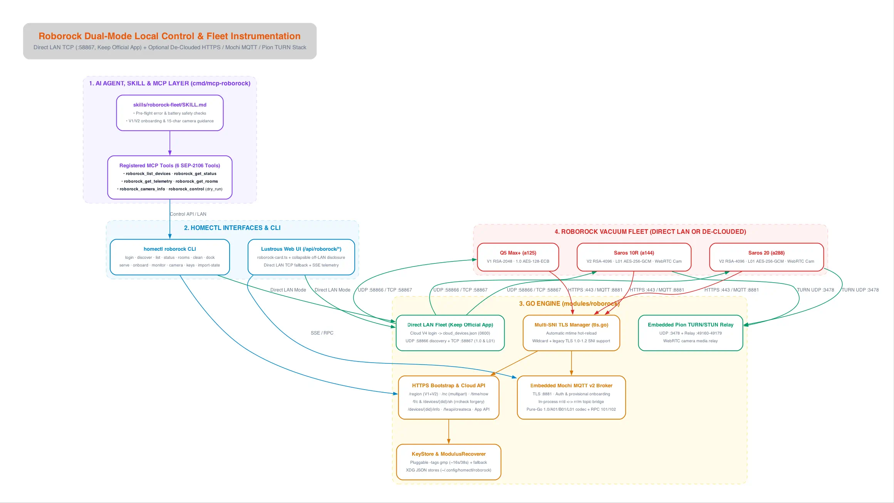

The Roborock vertical (`modules/roborock`) is a native Go port of [`Python-roborock/local_roborock_server`](https://github.com/Python-roborock/local_roborock_server) (building on Dennis Giese's firmware research and `python-roborock`). It consolidates what was previously a 6-process Python/Docker stack into a single Go binary inside `homectl`.

## Architectural Highlights

### 1. Pure-Go Wire Codec (`protocol.go`)
Implements byte-exact framing and symmetric encryption across all four Roborock transport versions with zero external dependencies:
- **`1.0`**: AES-128-ECB + PKCS#7 using permuted-timestamp MD5 key derivation (`TXdfu$jyZ#TZHsg4` salt).
- **`A01` / `B01`**: AES-128-CBC using random-seeded MD5 IV derivation.
- **`L01`**: AES-256-GCM (used by Saros 10R / Saros 20 local TCP `:58867`) with `connect_nonce` and `ack_nonce` AAD authentication.

### 2. Pluggable RSA Public-Key Recovery (`crypto.go`, `recover_gmp.go`, `recover_fallback.go`)
During initial onboarding, vacuums sign requests to `/region` with their on-device RSA private key (RSA-2048/SHA-256 for V1, RSA-4096/SHA-384 for V2). Computing `GCD(sig^65537 - EM)` on 134M–268M-bit integers requires subquadratic Half-GCD:
- **`-tags gmp` (`make build-gmp`)**: Native CGO `libgmp` backend (~16s for RSA-2048, ~38s for RSA-4096).
- **Default Pure-Go (`CGO_ENABLED=0`)**: Zero C runtime dependencies for 24/7 headless Linux deployment — reads persisted `device_keys.json` or delegates one-time recovery to an external helper.

### 3. Embedded Mochi MQTT v2 Broker & Live Telemetry Tap (`mqtt_broker.go`, `telemetry.go`)
Replaces external Mosquitto, Python TLS proxy, and `aiomqtt` topic bridge with an in-process Mochi MQTT v2 TLS listener (`:8881`):
- Authenticates vacuums, learns provisional onboarding credentials on first `rr/d/i/{did}/{usr}` publish, and bridges `rr/d/* ↔ rr/m/*`.
- Decodes every frame in-process into a thread-safe `TelemetryHub` (battery, state, error codes, fan/water modes, protocol `203` firmware reports, RPC `101`/`102` traces, and map frames `300`/`301`).
- Provides an inline `MQTTController` so `homectl` CLI, Web UI, and `mcp-roborock` send active RPC commands directly without needing Home Assistant.

### 4. Multi-SNI Hot-Reload TLS & 48-Hour `rrcheck` Grant Forgery (`tls.go`, `http_server.go`)
- `MultiSNICertManager` maps exact/wildcard SNI hostnames to PEM files and automatically hot-reloads renewed certificates with zero downtime.
- `POST /f/c` and `GET /devices/{did}/sh` forge valid `{k, d}` RSA-OAEP + AES-128-ECB acceptance grants using each device's recovered public key, preventing `-10002 rrcheck access denied` lockouts on WAN-blocked vacuums.

### 5. Embedded Pion TURN/STUN Relay (`turn.go`, `camera.go`)
Embeds `github.com/pion/turn/v4` on UDP `3478` (relay range `49160–49179`) and serves `POST /fwapi/createca` for local WebRTC camera previews on camera-equipped models (Saros 10R `a144`, Saros 20 `a288`).
